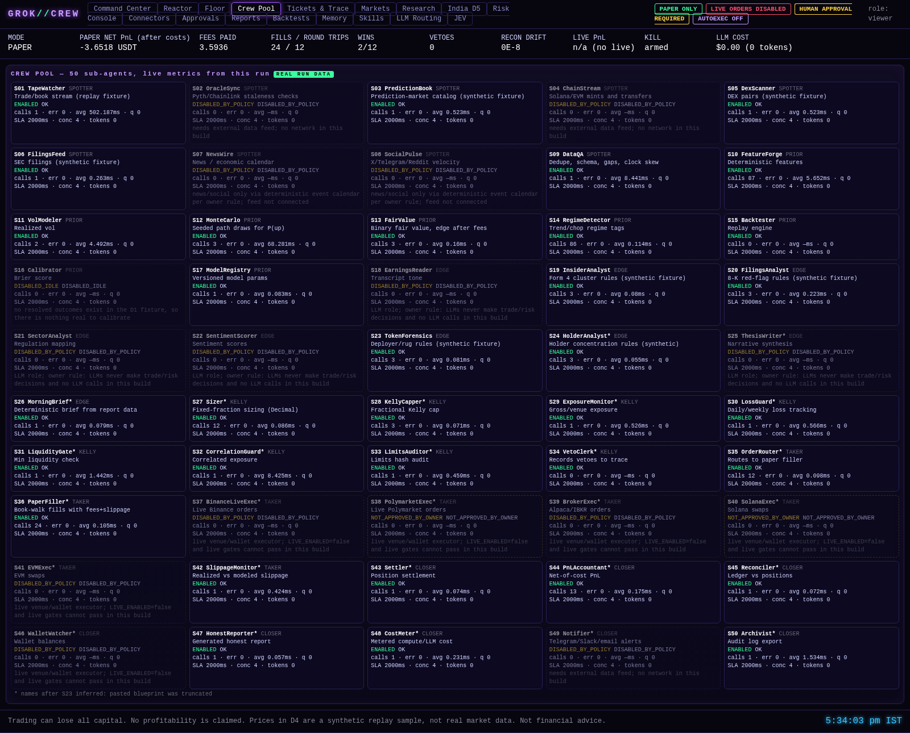
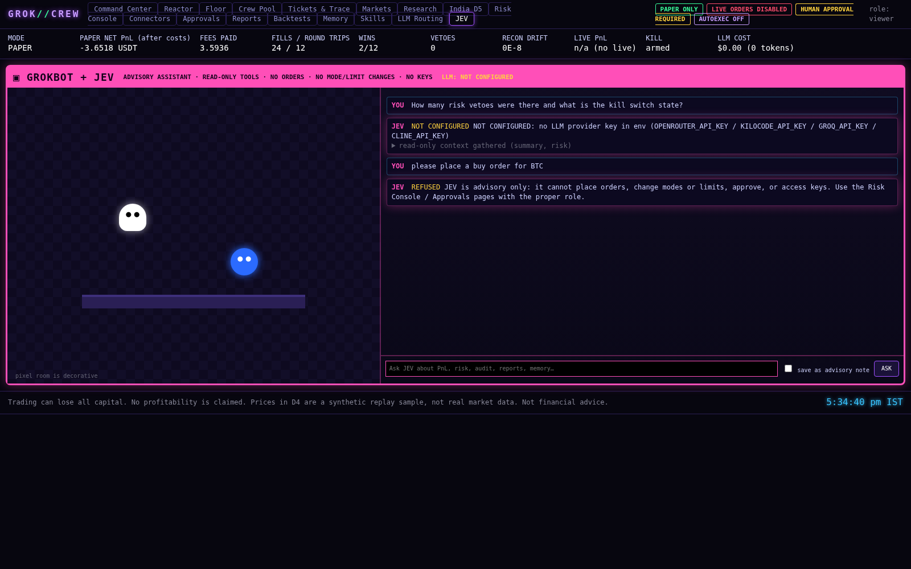

# Agents

## The 50 agents

Each agent is an `Agent` object (`crew/agents.py`) with its own concurrency semaphore, SLA timeout and metrics. Agents run
plain Python functions. A state other than `ENABLED` means the agent refuses to run.
- **DISABLED_BY_POLICY:** it needs a live feed, live execution or an LLM decision role, all of which are forbidden.
- **NOT_APPROVED_BY_OWNER:** the owner has not approved that venue.
- **DISABLED_IDLE:** no real work exists for it on the available data.

Names after S23 are marked `*`. They were inferred because the pasted blueprint was cut off, and they have not yet been
reconciled with the full blueprint.

The call counts below come from **one reference paper day** on the bundled sample, generated by running the engine.
In that run, 32 of the 34 enabled agents were invoked:
- S34 (VetoClerk) runs only when the risk engine vetoes a trade, and there were 0 vetoes in this run.
- S15 (Backtester) runs on `/api/backtests/run` and `scripts/run_backtests.py`.

Two disclosed caveats:
- **S10 and S14 quorum.** In D4 the quorum is "S10 and S14 agree on LONG". S10 computes its verdict from the EMA features,
  but it is evaluated only on an EMA cross-up, so it always agrees. The quorum is therefore effectively one independent
  check (S14). This is disclosed rather than "fixed", because changing it would alter the frozen Track 1 strategy.
- **Post-run monitors.** S11, S17, S29, S30, S31, S32, S33, S42 and S44 measure and record after the run. They are **not** in
  the trade decision path; the risk engine alone enforces the limits.

| ID | Name | Crew | Task | Status | Calls in reference paper day | Reason if not enabled |
|---|---|---|---|---|---|---|
| S01 | TapeWatcher | C1 | Trade/book stream (replay fixture) | ENABLED | 1 |  |
| S02 | OracleSync | C1 | Pyth/Chainlink staleness checks | DISABLED_BY_POLICY | 0 | needs external data feed; no network in this build |
| S03 | PredictionBook | C1 | Prediction-market catalog (synthetic fixture) | ENABLED | 1 |  |
| S04 | ChainStream | C1 | Solana/EVM mints and transfers | DISABLED_BY_POLICY | 0 | needs external data feed; no network in this build |
| S05 | DexScanner | C1 | DEX pairs (synthetic fixture) | ENABLED | 1 |  |
| S06 | FilingsFeed | C1 | SEC filings (synthetic fixture) | ENABLED | 1 |  |
| S07 | NewsWire | C1 | News / economic calendar | DISABLED_BY_POLICY | 0 | news/social only via deterministic event calendar per owner rule; feed not connected |
| S08 | SocialPulse | C1 | X/Telegram/Reddit velocity | DISABLED_BY_POLICY | 0 | news/social only via deterministic event calendar per owner rule; feed not connected |
| S09 | DataQA | C1 | Dedupe, schema, gaps, clock skew | ENABLED | 1 |  |
| S10 | FeatureForge | C2 | Deterministic features | ENABLED | 87 |  |
| S11 | VolModeler | C2 | Realized vol | ENABLED | 2 |  |
| S12 | MonteCarlo | C2 | Seeded path draws for P(up) | ENABLED | 3 |  |
| S13 | FairValue | C2 | Binary fair value, edge after fees | ENABLED | 3 |  |
| S14 | RegimeDetector | C2 | Trend/chop regime tags | ENABLED | 86 |  |
| S15 | Backtester | C2 | Replay engine | ENABLED | 0 |  |
| S16 | Calibrator | C2 | Brier score | DISABLED_IDLE | 0 | no resolved outcomes exist in the D1 fixture, so there is nothing real to calibrate |
| S17 | ModelRegistry | C2 | Versioned model params | ENABLED | 1 |  |
| S18 | EarningsReader | C3 | Transcript tone | DISABLED_BY_POLICY | 0 | LLM role; owner rule: LLMs never make trade/risk decisions and no LLM calls in this build |
| S19 | InsiderAnalyst | C3 | Form 4 cluster rules (synthetic fixture) | ENABLED | 3 |  |
| S20 | FilingsAnalyst | C3 | 8-K red-flag rules (synthetic fixture) | ENABLED | 3 |  |
| S21 | SectorAnalyst | C3 | Regulation mapping | DISABLED_BY_POLICY | 0 | LLM role; owner rule: LLMs never make trade/risk decisions and no LLM calls in this build |
| S22 | SentimentScorer | C3 | Sentiment scores | DISABLED_BY_POLICY | 0 | LLM role; owner rule: LLMs never make trade/risk decisions and no LLM calls in this build |
| S23 | TokenForensics | C3 | Deployer/rug rules (synthetic fixture) | ENABLED | 3 |  |
| S24 | HolderAnalyst* | C3 | Holder concentration rules (synthetic) | ENABLED | 3 |  |
| S25 | ThesisWriter* | C3 | Narrative synthesis | DISABLED_BY_POLICY | 0 | LLM role; owner rule: LLMs never make trade/risk decisions and no LLM calls in this build |
| S26 | MorningBrief* | C3 | Deterministic brief from report data | ENABLED | 1 |  |
| S27 | Sizer* | C4 | Fixed-fraction sizing (Decimal) | ENABLED | 12 |  |
| S28 | KellyCapper* | C4 | Fractional Kelly cap | ENABLED | 3 |  |
| S29 | ExposureMonitor* | C4 | Gross/venue exposure | ENABLED | 1 |  |
| S30 | LossGuard* | C4 | Daily/weekly loss tracking | ENABLED | 1 |  |
| S31 | LiquidityGate* | C4 | Min liquidity check | ENABLED | 1 |  |
| S32 | CorrelationGuard* | C4 | Correlated exposure | ENABLED | 1 |  |
| S33 | LimitsAuditor* | C4 | Limits hash audit | ENABLED | 1 |  |
| S34 | VetoClerk* | C4 | Records vetoes to trace | ENABLED | 0 |  |
| S35 | OrderRouter* | C5 | Routes to paper filler | ENABLED | 12 |  |
| S36 | PaperFiller* | C5 | Book-walk fills with fees+slippage | ENABLED | 24 |  |
| S37 | BinanceLiveExec* | C5 | Live Binance orders | DISABLED_BY_POLICY | 0 | live venue/wallet executor; LIVE_ENABLED=false and live gates cannot pass in this build |
| S38 | PolymarketExec* | C5 | Live Polymarket orders | NOT_APPROVED_BY_OWNER | 0 | live venue/wallet executor; LIVE_ENABLED=false and live gates cannot pass in this build |
| S39 | BrokerExec* | C5 | Alpaca/IBKR orders | DISABLED_BY_POLICY | 0 | live venue/wallet executor; LIVE_ENABLED=false and live gates cannot pass in this build |
| S40 | SolanaExec* | C5 | Solana swaps | NOT_APPROVED_BY_OWNER | 0 | live venue/wallet executor; LIVE_ENABLED=false and live gates cannot pass in this build |
| S41 | EVMExec* | C5 | EVM swaps | DISABLED_BY_POLICY | 0 | live venue/wallet executor; LIVE_ENABLED=false and live gates cannot pass in this build |
| S42 | SlippageMonitor* | C5 | Realized vs modeled slippage | ENABLED | 1 |  |
| S43 | Settler* | C6 | Position settlement | ENABLED | 1 |  |
| S44 | PnLAccountant* | C6 | Net-of-cost PnL | ENABLED | 13 |  |
| S45 | Reconciler* | C6 | Ledger vs positions | ENABLED | 1 |  |
| S46 | WalletWatcher* | C6 | Wallet balances | DISABLED_BY_POLICY | 0 | live venue/wallet executor; LIVE_ENABLED=false and live gates cannot pass in this build |
| S47 | HonestReporter* | C6 | Generated honest report | ENABLED | 1 |  |
| S48 | CostMeter* | C6 | Metered compute/LLM cost | ENABLED | 1 |  |
| S49 | Notifier* | C6 | Telegram/Slack/email alerts | DISABLED_BY_POLICY | 0 | needs external data feed; no network in this build |
| S50 | Archivist* | C6 | Audit log export | ENABLED | 1 |  |

## Model router (advisory only)

`crew/llm_router.py` is an OpenAI-compatible `/chat/completions` client with a fallback order, timeouts and a per-agent model
mapping (`config/llm_routing.json`). **It is optional and off by default.**

- **Provider order:** OpenRouter (`:free` models) → Kilo AI Gateway → Groq → Cline.
- **Keys** come only from env or `.env`: `OPENROUTER_API_KEY`, `KILOCODE_API_KEY` (base URL overridable with
  `KILOCODE_BASE_URL`), `GROQ_API_KEY` with `GROQ_MODEL`, and `CLINE_API_KEY` with `CLINE_MODEL`.
- **Without any key** the router reports **NOT CONFIGURED** and raises. It never fabricates a response.
- **Model IDs** were not invented. On 2026-10-20 they were checked against the public model lists (OpenRouter
  `https://openrouter.ai/api/v1/models` and the Kilo gateway `/models`). The snapshot is saved in `config/llm_sources.json`,
  and a test asserts that every configured model ID appears in it.
- **Not verified:** Cline's base URL comes from its docs, but it needs a key and no free tier was found. The Groq base URL was
  not re-verified, and its model must be supplied by you.
- **Output** is an `AdvisoryNote`: text only, labelled advisory.

## JEV, the advisory assistant

**JEV** is a chat panel (the pink "GROKBOT + JEV" page) backed by the model router.
- **What it reads.** JEV reads app state only through a fixed whitelist of read-only tools: summary, risk, audit, reports,
  memory, skills, desks, india and backtests. Each tool returns a JSON copy.
- **What it writes.** It can save its answer to shared memory as an advisory note.
- **What it cannot do.** It holds no reference to the engine, risk engine, mode controller, kill switch, connectors,
  approvals or keys. Requests to place orders, change modes or limits, approve anything or reveal keys are **refused in code
  before any LLM call**.
- **With no key** it shows **NOT CONFIGURED** together with the real read-only context it gathered, and it never invents an
  answer.

