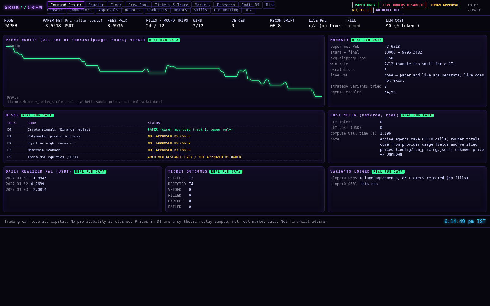

# Trading Crew


[](https://github.com/CodesbyFebin/Trading-Crew-app/actions/workflows/ci.yml)
[](https://github.com/CodesbyFebin/Trading-Crew-app/blob/main/LICENSE)


---

> **Verification status.** Public Binance Spot prices and candles can stream live, without credentials. That feed is read-only and is not connected to strategy evaluation or portfolio accounting. The bundled strategy results use synthetic or replay data. The production authenticated account and order lifecycle is not qualified: see [the live-gate report](reports/LIVE_GATES.md). No strategy profitability is claimed. Trading can lose all of your capital.
> Nothing here is financial advice, and the project makes **no profit claims of any kind**.

Trading Crew is an open-source Python/FastAPI application that models a "crew" of 50 small, typed, deterministic agents.
Together they take a market-data replay through data QA, feature engineering, regime detection, sizing, a hard-coded risk
engine, paper fills, settlement, reconciliation and honest reporting. A dashboard shows every step, and an append-only ledger
and trace record every decision.

**Repository topics:** dashboard, python, risk-management, websocket, market-data.

**Verification scope:** automated tests and local drills cover application behavior and offline execution contracts. They do not establish production readiness, exchange order capability, or profitable performance. The current gate-by-gate status and evidence are maintained in [`reports/LIVE_GATES.md`](reports/LIVE_GATES.md).

The D4 replay now reports causal trend, volatility and spread labels and groups closed paper outcomes by the regime at entry.
This report is descriptive only: it does not route strategies, and the bundled synthetic sample is too short to establish an edge.

The project is built with a **risk-officer mindset**. Capital preservation comes first, risk controls fail closed, and every
number on the dashboard is either a real output of the code running on the bundled sample data or clearly labelled as
decorative or synthetic. When something is missing, the app says so ("NOT CONFIGURED", "DISABLED_BY_POLICY",
"CALENDAR_MISSING"). It never fills the gap with plausible-looking fake data.

Trading Crew command center dashboard


### Try it locally

```bash
git clone https://github.com/CodesbyFebin/Trading-Crew-app.git
cd Trading-Crew-app
scripts/run_all.sh
```

The script creates a virtual environment, runs tests and safety drills, runs the bundled replay, and serves the dashboard
on `http://127.0.0.1:8795`. If no session tokens are configured, generated local-only tokens are saved to
`var/session.env` (mode 600, gitignored). **No exchange keys or network trading connection are used.** The optional default market feed connects only to Binance public market-data endpoints.

See [Quickstart](#quickstart), [safety architecture](#safety-architecture), [known limitations](#audit-summary-and-known-limitations),
and the [17-page dashboard screenshots](https://github.com/CodesbyFebin/Trading-Crew-app/tree/main/screenshots).

---

https://github.com/user-attachments/assets/921bd35d-f0c2-4785-a968-8ec8f61867fe




## What this is (and is not)

**It is:**
- A reproducible **research and paper-trading harness**. Given the same input file it produces the same fills, the same fees
  and the same report, down to the last decimal. All money math uses Python `Decimal`, never floats.
- A **reference implementation of trading safety controls**: a fail-closed risk engine, immutable file-based limits with
  tamper detection, a kill switch, a promotion ladder that requires signed owner approval, and an append-only audit trail
  enforced by database triggers.
- A **multi-agent pipeline** in which every "agent" is ordinary deterministic Python with metrics (calls, errors, average
  latency, SLA breaches, queue depth) that the dashboard shows live.
- A **dashboard** (FastAPI and vanilla JavaScript) with 19 pages, including a Control Room and a reference-inspired Showcase wired to the app's
  run, agent, risk, audit, memory, skills and paper-fill APIs: Command Center, Reactor, Floor, Crew Pool, Tickets & Trace,
  Markets, Research, India D5, Risk Console, Connectors, Approvals, Reports, Backtests, Memory, Skills, LLM Routing and JEV.

**It is not:**
- A trading bot you can point at an exchange. Live adapters exist only as stubs that raise before any network code could run.
- An AI that decides trades. **No large language model (LLM) ever makes a trade or risk decision.** The optional LLM gateway
  can only produce advisory text notes. A test proves that no LLM code path can reach the order, risk or mode modules.
- A profitable strategy. The sample strategy is a placeholder (an EMA crossover gated by a regime filter). On the bundled
  synthetic sample it **loses money after costs** (see [Reference results](#reference-results-synthetic-data)).

## Disclaimers

- **Paper execution only.** This software does not place real orders. It can connect to public, unauthenticated Binance Spot market-data endpoints for display.
- **Not financial advice.** Nothing in this repository is investment, legal or tax advice.
- **No profit claims.** No result here shows or implies future profitability. The reference results are negative after costs.
- **Synthetic results.** Every strategy, backtest, paper fill and PnL result comes from synthetic or replayed sample data; live prices are not used for those results.
- **Your responsibility.** If you modify this software to trade real money, you alone are responsible for compliance
  (including SEBI rules in India and the rules in your own jurisdiction) and for any losses. Trading can lose all of your capital.
