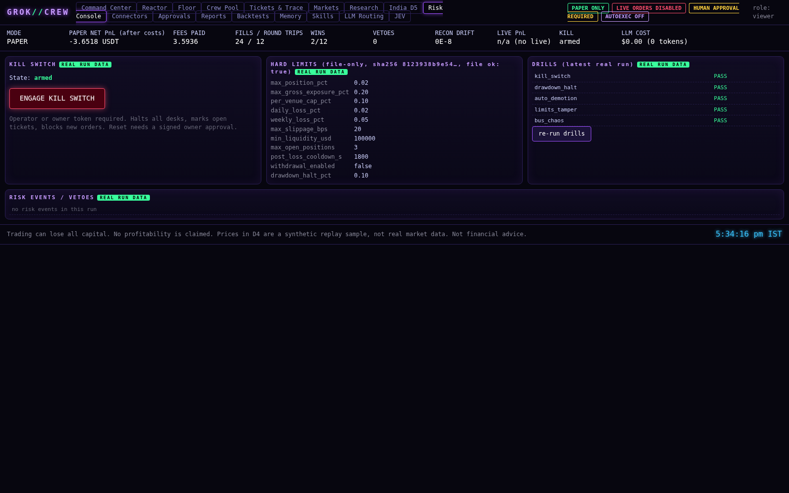

# Safety

## Safety architecture

The safety design rests on one principle: **hard limits live in code and files outside any model, and every failure mode
blocks the trade instead of allowing it.**

### 1. Deterministic risk engine (`crew/risk.py`)
Every order intent passes through `RiskEngine.check()` before a paper fill can happen.
- **Fail closed.** The check runs with a timeout. If it times out, raises an exception or returns the wrong type, the order
  is vetoed with a reason that starts with `fail-closed:`.
- **At-limit counts as a breach.** Comparisons use `>=`, so an exposure exactly equal to a cap is rejected.
- **Decimal only.** Non-Decimal numeric inputs are rejected, which caught a real bug during development (an empty `sum()`
  returned an `int`).
- **Limits come from `config/limits.json`** and are loaded read-only, together with their SHA-256 hash. A `LimitsAuditor`
  re-hashes the file and logs `LIMITS_FILE_CHANGED` as a critical risk event when the file is modified. The API refuses any
  attempt to change limits at runtime and writes that attempt to the audit log.

The limits currently in `config/limits.json`:

| Limit | Value |
|---|---|
| max position (fraction of equity) | 0.02 |
| max gross exposure | 0.20 |
| per-venue cap | 0.10 |
| daily loss | 0.02 |
| weekly loss | 0.05 |
| max slippage | 20 bps |
| min liquidity (24h quote volume) | 100,000 USD |
| max open positions | 3 |
| post-loss cooldown | 1,800 s |
| withdrawals | disabled (`false`) |
| drawdown halt | 0.10 |

### 2. Kill switch (`crew/killswitch.py`)
An operator or owner can engage the kill switch from the Risk Console or with `POST /api/kill`. It blocks new paper orders
and marks open tickets. Order submission and kill acknowledgment are serialized. This replay/paper build does not own a
live position or exchange connection, so the kill switch does **not** flatten external positions. Resetting it requires a
signed owner approval.

**Automatic daily-loss kill.** When the risk engine sees a daily-loss breach (at-limit counts) it only returns a veto with
the reason `daily loss limit breached`; the risk worker has no side effects. The engine then engages the global kill on its
own event loop through the same `engage_kill` path as `POST /api/kill`: every desk is halted, open tickets are
cancelled/expired, and a `KILL` risk event plus an audit row (actor `risk-engine:auto`) are written to the store under the
run's `run_id`. Fills are serialised against kills: the kill state is re-checked under a lock immediately before any paper
fill is recorded, and a fill that loses the race is discarded. A new trading day does not clear the kill; only a valid
HMAC-signed owner `kill:reset` approval does. Daily loss is currently measured on **realized** PnL; including open-position
mark-to-market is an open owner decision because it changes Track 1 risk inputs.

### 3. Signed approvals (`crew/models.py`)
Owner approvals are HMAC-signed with a key read from the `CREW_APPROVAL_HMAC_KEY` environment variable. Without the key,
approvals cannot be signed. A signed approval is **necessary but not sufficient**: the promotion gates still apply.

### 4. Append-only storage (`crew/store.py`, `crew/memory.py`)
The trace, ledger, risk events, audit log and shared memory are append-only. In SQLite, `BEFORE UPDATE` and `BEFORE DELETE`
triggers raise an error. In Postgres, a PL/pgSQL trigger function does the same. All writes go through a process-wide lock.

### 5. Authentication and roles (`crew/auth.py`, `crew/api.py`)
- Three roles: **owner** (view, research, approve, kill, mode change, config), **operator** (view, research, kill) and **viewer** (view).
- Tokens come from environment variables only and are accepted **only** in the `Authorization: Bearer` header. Tokens in the
  URL are rejected, and the UI removes them from the address bar.
- The WebSocket authenticates with a first message `{"auth": "<token>"}` sent within 5 seconds.
- Optional **TOTP** (time-based one-time password) for owner actions: set `CREW_OWNER_TOTP_SECRET` and send an `X-TOTP`
  header. It is disabled when the variable is unset.

### 6. LLM isolation
`tests/test_brain.py::test_no_llm_path_reaches_order_risk_mode_code` parses the source of every decision module (risk, modes,
kill switch, engine, connectors, desks, overseer, models, bus, store, agents, drills, skills, backtest) and fails if any of
them imports the LLM router, JEV or memory-read functions. The engine only *writes* deterministic facts to memory; it never
reads them back.

### 7. Secrets policy
- No keys in code, chat or command-line arguments.
- Secrets live only in `.env`, which is gitignored; `.env.example` lists the variables with empty values.
- The application needs **no exchange keys at all**, and no key may ever have withdrawal permission.



## Observability, run isolation and data guards

**Run isolation (`run_id`).**
- Every row in the trace, ledger, risk events and audit log carries the store's `run_id` (a UUID).
- Keys and indexes:
  - SQLite: trace has the composite primary key `(run_id, trace_id)`; every table gets a unique index on `(run_id, seq|trace_id)` and an index on `run_id`.
  - Postgres: the same indexes are added.
- All reads behind drift, wins and net PnL are scoped to the current `run_id`, so two runs sharing one database cannot
  pollute each other. Tests run two concurrent paper days on one SQLite file (and on Postgres), and each matches an isolated run.
- **Migration.** Older databases get `run_id` added with `ALTER TABLE ... ADD COLUMN ... DEFAULT 'legacy'`, so older rows
  stay readable under the `legacy` run.
- **Concurrent setup.** Schema creation is serialised: an in-process lock with a SQLite busy timeout, and a Postgres advisory lock.

**LLM metering.**
- The router records `prompt_tokens` and `completion_tokens` from each provider response's `usage` field.
- Cost is computed only from `config/llm_pricing.json`. Those prices were copied on 2026-10-20 from the public OpenRouter and
  Kilo model-list APIs, and each entry records its source URL. All configured models are free (price 0).
- Any other model, or a response without `usage`, is costed as **UNKNOWN** and is never guessed.
- The header's LLM cost combines the engine's 0 calls with the router's real totals.

**Prometheus metrics: `GET /api/v1/metrics`.**
- Requires a viewer token. In Prometheus, set `authorization: {type: Bearer, credentials_file: ...}`; keep the server bound
  to localhost or behind a reverse proxy.
- The registry is built fresh on each scrape from the current run's telemetry. Series:
  - `crew_intents_submitted_total`;
  - `crew_rejects_total{reason}` (no_quorum, risk:&lt;reason&gt;, stale_data:&lt;why&gt;, kill_switch);
  - `crew_risk_breaches_total`;
  - `crew_quorum_outcomes_total{outcome}`;
  - `crew_signal_to_decision_seconds` (histogram of wall time from signal to ticket decision);
  - `crew_kill_switch_engaged`;
  - `crew_mode_info{mode,run_id}`;
  - `crew_bus_dlq_size{source="drill"}`. This comes from the last bus_chaos drill, because the runtime engine has no message bus.
- In the reference run: 86 signals, 74 rejected for no quorum, 12 intents submitted, 0 risk breaches.

**Offline order book and feed guard (`crew/orderbook.py`).**
- `L2Book` validates the book (sorted, positive, not crossed) and gives spread, depth (optionally within N bps of mid) and a
  VWAP fill-cost estimate with impact versus best price and versus mid. It is tested on the replay fixture.
- `StalenessGuard` blocks **signal evaluation** when a symbol's data gap exceeds `max_gap_s`, when timestamps go backwards, or
  when exchange time drifts from local time by more than `max_drift_s`. The settings are in `config/feed_guard.json`
  (120 s and 5 s); they are not risk limits.
- It is wired into the D4 replay. The bundled fixture has no gaps, so it never fires there and results are unchanged.
- A test injects a 10-minute gap and checks that evaluation is blocked.
- **No live feed is connected.**

**Charts.**
- The Markets page shows TradingView Lightweight Charts™ v5.2.1 candlesticks (vendored unmodified, Apache-2.0; see
  `web/vendor/lightweight-charts/NOTICE`). They are 15-minute OHLC of the synthetic replay mid price, with this run's paper
  fills as markers.
- The Risk Console has a **limit-utilisation heatmap**: value divided by limit for every real limit in `config/limits.json`,
  at the last risk check and the peak over the run (≥ 100% means a breach, and at-limit counts).

## Testing and drills

```bash
.venv/bin/pytest -q tests                                       # unit, integration and API tests
TEST_DATABASE_URL=postgresql://... .venv/bin/pytest -q tests    # also runs the Postgres tests
/workspace/.pwvenv/bin/python -m pytest tests_e2e               # Playwright smoke test of all 17 pages (needs playwright)
.venv/bin/python scripts/run_drills.py                          # safety drills; exits non-zero on failure
```

What the test suite covers:
- the ticket state machine;
- risk at-limit breaches and fail-closed behaviour;
- limits tampering;
- signed approvals;
- the mode gates;
- the bus (leases, idempotency, dead-letter queue, backpressure);
- the append-only triggers;
- paper reconciliation;
- RBAC, header-only auth, WebSocket first-message auth and TOTP;
- shared memory, the router (no key, and fallback), JEV refusals and LLM isolation;
- the skills;
- agent wiring;
- the JSON Schemas.

CI (`.github/workflows/ci.yml`) runs pytest against a Postgres service (`REQUIRE_POSTGRES=1` makes the job fail if the Postgres tests would be skipped), then the drills and a paper day.

**Drills** (`crew/drills.py`), all PASS in the latest run:
1. **kill_switch**: blocks new paper orders and marks open tickets. No external positions can be flattened by this paper-only build.
2. **drawdown_halt**: passes at 5% drawdown, blocks at 10%, and the block persists.
3. **auto_demotion**: LIVE_APPROVAL → PAPER → REPLAY.
4. **limits_tamper**: a modified limits file is detected.
5. **bus_chaos**: duplicates, a simulated 429, lease timeouts, the dead-letter queue and backpressure are all handled.
6. **daily_loss_kill**: runs the real paper day with the risk engine fed an at-limit daily loss from the third order intent;
   the kill engages once, halts every desk, writes one `KILL` risk event and one audit row, no further fill is recorded,
   and an unsigned reset is refused.

## Audit summary and known limitations

The full audit, with file and line references, is in [`reports/AUDIT.md`](https://github.com/CodesbyFebin/Trading-Crew-app/blob/main/reports/AUDIT.md). It lists 35 items:
- **23 fixable offline:** fixes are recorded inline in the audit table.
- **8 blocked by owner policy or by needing real data or keys.**
- **11 intentional safety stubs.**
- **1 uncategorised:** "Jev-Claw", which could not be identified.

Known limitations, stated plainly:
- **Data.** All market data is synthetic or replayed. There is no live or testnet connection, by owner policy, until the
  paper logs are reviewed and approved.
- **Unverified assumptions.**
  - the 10 bps Binance fee rate;
  - the 2% prediction-market fee;
  - the SEBI threshold of 10 orders per second;
  - no connector's venue documentation has been verified.
- **India D5.** No verified blackout calendar exists, so every entry is blocked.
- **Quorum.** The D4 quorum is effectively one independent lane (see the S10 note above).
- **Redis.** The Redis adapter has been tested only against fakeredis, and the runtime engine does not use it.
- **Docker.** `docker compose` and app-to-Postgres networking inside Docker are not yet verified.
- **LLM cost metering** has been tested only with mocked provider responses. No real provider call has been made, because
  no key is configured.
- **Agent names.** S24–S50 have inferred names.
